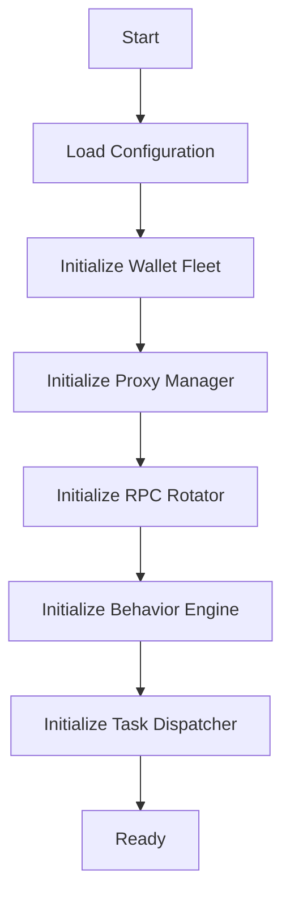
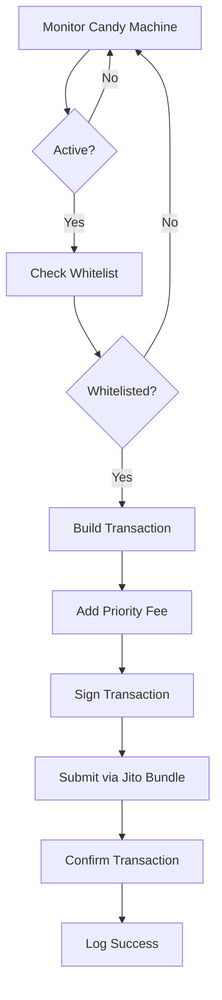
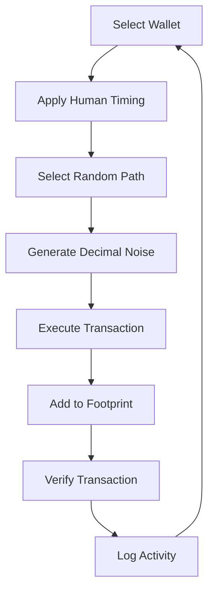
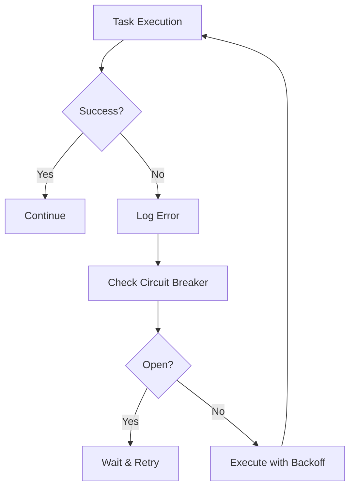
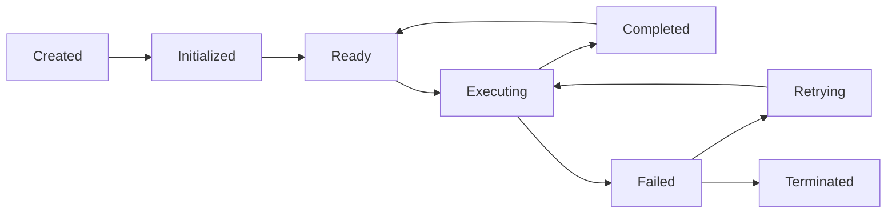

# 🤖 **BOTAIRDROP AGENT SYSTEM**
## **نظام الوكلاء الذكي لإدارة قطيع محافظ Solana**

---

## 🎯 **ملخص النظام**

**BOTAIRDROP** هو نظام **Multi-Agent** متكامل لإدارة **100+ محفظة Solana** بهدف:
1. **Airdrop Farming** - توليد سجل معاملات عضوي يتخطى أنظمة كشف Sybil
2. **Auto NFT Sniper** - قنص و جمع NFTs النادرة فور طرحها
3. **Stealth Operations** - تخفي جميع العمليات لتجنب الكشف

---

## 🏗️ **النمط المعماري (Architecture Pattern)**

### **1. Multi-Agent System (نظام الوكلاء المتعددة)**
```
┌─────────────────────────────────────────────────────────────────────┐
│                        BOTAIRDROP AGENT SYSTEM                       │
├─────────────────────────────────────────────────────────────────────┤
│                                                                     │
│  ┌─────────────┐    ┌─────────────┐    ┌─────────────┐            │
│  │   Agent 1   │    │   Agent 2   │    │   Agent N   │            │
│  │ (Wallet 1)  │    │ (Wallet 2)  │    │ (Wallet N)  │            │
│  └──────┬──────┘    └──────┬──────┘    └──────┬──────┘            │
│         │                  │                  │                    │
│         ▼                  ▼                  ▼                    │
│  ┌─────────────────────────────────────────────────────────────┐   │
│  │                    AGENT FLEET MANAGER                      │   │
│  │  - Coordinates all agents                                    │   │
│  │  - Distributes tasks                                         │   │
│  │  - Manages resources                                         │   │
│  │  - Handles errors                                            │   │
│  └─────────────────────────────────────────────────────────────┘   │
│         │                                                          │
│         ▼                                                          │
│  ┌─────────────────────────────────────────────────────────────┐   │
│  │                    TASK DISPATCHER                           │   │
│  │  - NFT Minting Tasks                                         │   │
│  │  - Airdrop Farming Tasks                                     │   │
│  │  - Transaction Tasks                                         │   │
│  │  - Monitoring Tasks                                          │   │
│  └─────────────────────────────────────────────────────────────┘   │
│                                                                     │
└─────────────────────────────────────────────────────────────────────┘
```

### **2. Agent Architecture (هيكلية كل وكيل)**
```
┌─────────────────────────────────────────────────────────────────────┐
│                         SINGLE AGENT                             │
├─────────────────────────────────────────────────────────────────────┤
│                                                                     │
│  ┌─────────────────────────────────────────────────────────────┐   │
│  │                     WALLET MANAGER                           │   │
│  │  - Keypair Storage (Encrypted)                              │   │
│  │  - Balance Tracking                                          │   │
│  │  - Transaction Signing                                       │   │
│  └─────────────────────────────────────────────────────────────┘   │
│                              │                                      │
│                              ▼                                      │
│  ┌─────────────────────────────────────────────────────────────┐   │
│  │                   NETWORK MANAGER                            │   │
│  │  - Proxy Binding (1:1 Static Residential)                     │   │
│  │  - RPC Endpoint Rotation                                     │   │
│  │  - Connection Pooling                                        │   │
│  └─────────────────────────────────────────────────────────────┘   │
│                              │                                      │
│                              ▼                                      │
│  ┌─────────────────────────────────────────────────────────────┐   │
│  │                   BEHAVIOR ENGINE                            │   │
│  │  - Path Polymorphism (Markov Chain)                          │   │
│  │  - Human Timing (Poisson/Gaussian Distribution)             │   │
│  │  - Decimal Noise Generator                                   │   │
│  │  - Browser Fingerprinting                                    │   │
│  └─────────────────────────────────────────────────────────────┘   │
│                              │                                      │
│                              ▼                                      │
│  ┌─────────────────────────────────────────────────────────────┐   │
│  │                   TASK EXECUTOR                              │   │
│  │  - Transaction Builder                                       │   │
│  │  - NFT Sniper                                                │   │
│  │  - Airdrop Farmer                                            │   │
│  │  - CAPTCHA Solver                                            │   │
│  └─────────────────────────────────────────────────────────────┘   │
│                                                                     │
└─────────────────────────────────────────────────────────────────────┘
```

### **3. Communication Pattern (نمط التواصل)**
- **Decentralized**: كل وكيل يعمل بشكل مستقل
- **Message Queue**: استخدام RabbitMQ/Redis للتواصل بين الوكلاء (اختياري)
- **Event-Driven**: الأحداث (Events) تطلق المهام
- **No Central Point of Failure**: لا يوجد نقطة فشل مركزية

---

## 📜 **القواعد الصارمة (Strict Rules)**

### **⚠️ Anti-Sybil Rules (قواعد ضد الكشف)**

#### **1. Zero-Linkage Topology (لا ارتباط مالي)**
- ❌ **ممنوع**: تحويل الأموال بين محافظ القطيع
- ✅ **مسموح**: التمويل من مصادر معزولة (CEX Sub-Accounts)
- ✅ **مسموح**: السحب إلى عناوين مختلفة
- ✅ **مسموح**: استخدام جسور متفرقة (Wormhole, Allbridge)

#### **2. Behavioral Entropy (فوضوية السلوك)**
- ❌ **ممنوع**: `setTimeout(5000)` - توقيت ثابت
- ✅ **مسموح**: `PoissonDistribution(mean=5000)` - توقيت عشوائي
- ✅ **مسموح**: `GaussianDistribution(mean=5000, stdDev=1500)` - توقيت طبيعي
- ✅ **مسموح**: `ExponentialBackoff()` - توقيت متزايد

#### **3. Path Polymorphism (تنوع المسارات)**
- ❌ **ممنوع**: جميع المحافظ تسلك نفس المسار (Jupiter → Raydium → Meteora)
- ✅ **مسموح**: كل محفظة لها مسار فريد (Markov Chain State Machine)
- ✅ **مسموح**: مسارات مختلفة حسب الـ Wallet ID Hash

#### **4. Decimal Noise (ضوضاء عشرية)**
- ❌ **ممنوع**: `0.015 SOL` - مبلغ منتظم
- ✅ **مسموح**: `0.015000483 SOL` - مبلغ مع ضوضاء
- ✅ **مسموح**: `0.014998721 SOL` - مبلغ مع ضوضاء سالبة

#### **5. Network Isolation (عزل الشبكة)**
- ❌ **ممنوع**: مشاركة نفس Proxy بين محفظتين
- ✅ **مسموح**: **1:1 Static Residential Proxy Binding** - كل محفظة لها Proxy فريد
- ✅ **مسموح**: كل محفظة لها User-Agent فريد
- ✅ **مسموح**: كل محفظة لها Browser Fingerprint فريد

### **⚠️ Security Rules (قواعد الأمان)**

#### **1. Key Management (إدارة المفاتيح)**
- ❌ **ممنوع**: تخزين المفاتيح في ملفات نصية غير مشفرة
- ✅ **مسموح**: تشفير المفاتيح في الذاكرة (In-Memory AES-256-GCM)
- ✅ **مسموح**: استخدام Environment Variables
- ✅ **مسموح**: استخدام Secret Management (AWS Secrets Manager, HashiCorp Vault)

#### **2. Transaction Signing (توقيع المعاملات)**
- ❌ **ممنوع**: طباعة Private Keys في Logs
- ✅ **مسموح**: توقيع المعاملات في الذاكرة فقط
- ✅ **مسموح**: مسح المفاتيح من الذاكرة بعد الاستخدام

#### **3. Error Handling (معالجة الأخطاء)**
- ❌ **ممنوع**: إيقاف النظام عند فشل محفظة واحدة
- ✅ **مسموح**: Circuit Breaker Pattern
- ✅ **مسموح**: Retry with Exponential Backoff + Jitter
- ✅ **مسموح**: تسجيل الأخطاء في نظام معزول

### **⚠️ Performance Rules (قواعد الأداء)**

#### **1. Rate Limiting (تحديد المعدل)**
- ✅ **مسموح**: تدوير RPC Endpoints عند Rate Limit (429)
- ✅ **مسموح**: استخدام Multiple RPC Providers (QuickNode, Alchemy, Helius)
- ✅ **مسموح**: Jito Bundles لأولوية التنفيذ

#### **2. Resource Management (إدارة الموارد)**
- ✅ **مسموح**: Connection Pooling
- ✅ **مسموح**: Memory Management (تجنب Memory Leaks)
- ✅ **مسموح**: CPU Throttling (تحديد استخدام المعالج)

---

## 🔄 **Workflow (سير العمل)**

### **1. Initialization Phase (مرحلة التهيئة)**


### **2. NFT Sniper Workflow (سير عمل قنص NFTs)**


### **3. Airdrop Farming Workflow (سير عمل Airdrop Farming)**


### **4. Error Handling Workflow (سير عمل معالجة الأخطاء)**


---

## 🎯 **Agent Types (أنواع الوكلاء)**

### **1. WalletAgent (وكيل المحفظة)**
**مسؤوليات:**
- إدارة مفاتيح المحفظة
- توقيع المعاملات
- إدارة الرصيد
- الاتصال بشبكة Solana

**خصائص:**
- `id: string` - معرّف فريد
- `keypair: Keypair` - زوج المفاتيح
- `proxy: ProxyConfig` - إعدادات Proxy
- `userAgent: string` - User-Agent فريد
- `fingerprint: BrowserFingerprint` - بصمة متصفح فريدة

### **2. SniperAgent (وكيل القنص)**
**مسؤوليات:**
- رصد Candy Machines
- قنص NFTs فور طرحها
- استخدام Jito Bundles
- تجنب Rate Limits

**خصائص:**
- `walletAgent: WalletAgent` - وكيل المحفظة
- `monitoringInterval: number` - فترة الرصد
- `priorityFee: number` - رسوم الأولوية

### **3. FarmerAgent (وكيل الزراعة)**
**مسؤوليات:**
- توليد سجل معاملات عضوي
- تنفيذ معاملات Airdrop Farming
- استخدام Path Polymorphism
- استخدام Human Timing

**خصائص:**
- `walletAgent: WalletAgent` - وكيل المحفظة
- `behaviorEngine: BehaviorEngine` - محرك السلوك
- `pathEngine: PathPolymorphismEngine` - محرك المسارات

### **4. StealthAgent (وكيل التخفي)**
**مسؤوليات:**
- تجنب أنظمة الكشف
- إدارة Proxies
- إدارة Browser Fingerprints
- حل CAPTCHA

**خصائص:**
- `proxyManager: ProxyManager` - مدير Proxies
- `captchaSolver: CaptchaSolver` - محلل CAPTCHA
- `fingerprintManager: FingerprintManager` - مدير البصمات

---

## 📊 **Agent Lifecycle (دورة حياة الوكيل)**



### **1. Created (إنشاء)**
- إنشاء الكائن
- تحميل الإعدادات

### **2. Initialized (تهيئة)**
- إعداد الاتصال بشبكة Solana
- إعداد Proxy
- إعداد Behavior Engine

### **3. Ready (جاهز)**
- انتظار المهام

### **4. Executing (تنفيذ)**
- تنفيذ المهام
- تسجيل الأحداث

### **5. Completed (انتهاء)**
- إكمال المهام بنجاح
- إرجاع النتائج

### **6. Failed (فشل)**
- تسجيل الخطأ
- محاولة إعادة التنفيذ

### **7. Retrying (إعادة المحاولة)**
- انتظار فترة
- إعادة التنفيذ

### **8. Terminated (إنهاء)**
- إيقاف الوكيل
- تحرير الموارد

---

## 🛡️ **Security Model (نموذج الأمان)**

### **1. Zero-Trust Architecture (هيكلية عدم الثقة)**
- كل وكيل **لا يثق** في أي وكيل آخر
- كل وكيل يعمل في **عزل تام**
- لا يوجد **Central Authority**

### **2. Encryption (التشفير)**
- **At Rest**: تشفير المفاتيح في قاعدة البيانات
- **In Transit**: تشفير جميع الاتصالات (TLS 1.3)
- **In Memory**: تشفير المفاتيح في الذاكرة

### **3. Access Control (تحكم في الوصول)**
- **Principle of Least Privilege**: كل وكيل له صلاحيات محدودة
- **Role-Based Access Control (RBAC)**: صلاحيات حسب الدور
- **Temporary Credentials**: مصادقة مؤقتة

---

## 🚀 **Deployment Strategy (استراتيجية النشر)**

### **1. Development Environment (بيئة التطوير)**
- **Local Machine**: اختبار فردي
- **Devnet**: اختبار على Solana Devnet
- **Mock Services**: خدمات وهمية

### **2. Staging Environment (بيئة الاختبار)**
- **Testnet**: اختبار على Solana Testnet
- **Real Proxies**: استخدام Proxies حقيقية
- **Real RPC**: استخدام RPC حقيقية

### **3. Production Environment (بيئة الإنتاج)**
- **Mainnet**: تشغيل على Solana Mainnet
- **High Availability**: توافر عالي
- **Monitoring**: رصد مستمر
- **Scaling**: قابلية التوسع

---

## 📈 **Monitoring & Analytics (الرصد والتحليل)**

### **1. Metrics (المقاييس)**
- **Success Rate**: نسبة نجاح المعاملات
- **Error Rate**: نسبة فشل المعاملات
- **Latency**: وقت استجابة النظام
- **Throughput**: عدد المعاملات في الثانية
- **Resource Usage**: استخدام الموارد (CPU, Memory, Network)

### **2. Logging (التسجيل)**
- **Transaction Logs**: تسجيل جميع المعاملات
- **Error Logs**: تسجيل جميع الأخطاء
- **Performance Logs**: تسجيل الأداء
- **Security Logs**: تسجيل الأحداث الأمنية

### **3. Alerts (التنبيهات)**
- **Rate Limit Alerts**: تنبيه عند تجاوز الحد
- **Error Alerts**: تنبيه عند فشل متكرر
- **Security Alerts**: تنبيه عند اكتشاف نشاط مشبوه

---

## 🔧 **Configuration (الإعدادات)**

### **1. Environment Variables (متغيرات البيئة)**
```env
# Solana Network
SOLANA_NETWORK=mainnet-beta
SOLANA_RPC_URL=https://api.mainnet-beta.solana.com

# Proxies
PROXY_PROVIDER=luminati
PROXY_API_KEY=your-api-key

# CAPTCHA
CAPTCHA_PROVIDER=2captcha
CAPTCHA_API_KEY=your-api-key

# Logging
LOG_LEVEL=info
LOG_FILE=logs/botairdrop.log

# Performance
MAX_CONCURRENT_TASKS=10
MAX_RETRIES=3
RETRY_DELAY=1000
```

### **2. Configuration Files (ملفات الإعدادات)**
```json
{
  "wallets": [
    {
      "id": "wallet-1",
      "publicKey": "...",
      "secretKey": "...",
      "proxyId": "proxy-1",
      "behavior": {
        "meanDelay": 5000,
        "stdDev": 1500,
        "path": ["Jupiter", "Raydium", "Meteora"]
      }
    }
  ],
  "proxies": [
    {
      "id": "proxy-1",
      "host": "proxy.provider.com",
      "port": 8080,
      "username": "user",
      "password": "pass",
      "type": "residential",
      "location": "US"
    }
  ]
}
```

---

## 📚 **References (المراجع)**

### **1. Architecture Patterns**
- [Multi-Agent System](https://en.wikipedia.org/wiki/Multi-agent_system)
- [Event-Driven Architecture](https://en.wikipedia.org/wiki/Event-driven_architecture)
- [Microservices](https://en.wikipedia.org/wiki/Microservices)

### **2. Solana Documentation**
- [Solana Docs](https://docs.solana.com/)
- [Solana Program Library](https://github.com/solana-labs/solana-program-library)
- [Metaplex](https://www.metaplex.com/)

### **3. Anti-Sybil Techniques**
- [Sybil Attack](https://en.wikipedia.org/wiki/Sybil_attack)
- [Behavioral Biometrics](https://en.wikipedia.org/wiki/Behavioral_biometrics)
- [Poisson Distribution](https://en.wikipedia.org/wiki/Poisson_distribution)

### **4. Security Best Practices**
- [OWASP Top 10](https://owasp.org/www-project-top-ten/)
- [Zero Trust Architecture](https://en.wikipedia.org/wiki/Zero_trust_security_model)
- [Encryption Standards](https://en.wikipedia.org/wiki/Encryption)

---

## 🎉 **Conclusion (الخاتمة)**

**BOTAIRDROP Agent System** هو نظام **Multi-Agent** متكامل و آمن و فعال لإدارة **100+ محفظة Solana**. النظام مصمم حسب **Best Practices** في:
- **Blockchain Development**
- **Multi-Agent Systems**
- **Anti-Sybil Techniques**
- **Security & Privacy**
- **Performance Optimization**

**الهدف النهائي:** بناء نظام **قوي، آمن، فعال، و غير قابل للكشف** لإدارة قطيع محافظ Solana. 🚀
